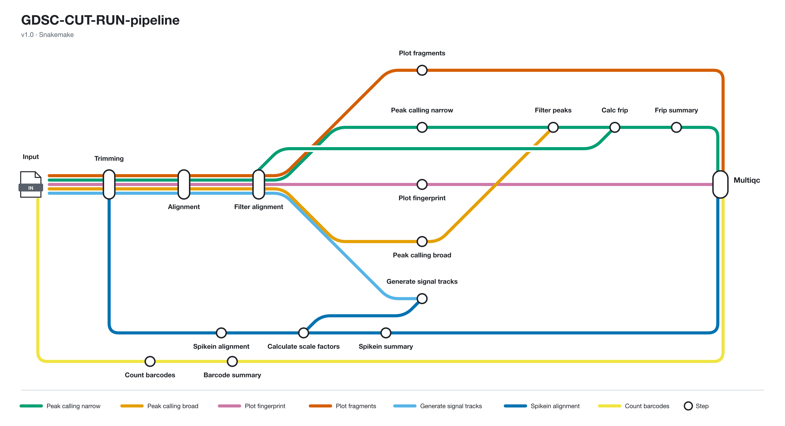

# slitherFlow 

**Subway maps for Snakemake pipelines.**


[](https://pixi.sh)
[](https://github.com/mikemartinez99/slitherFlow/actions/workflows/tests.yml)
[](https://mikemartinez99.github.io/slitherFlow/)
[](LICENSE)

slitherFlow turns a Snakemake pipeline into a subway-map figure, in the style of the nf-core pipeline diagrams. It reads your pipeline's rule graph, writes a first draft of the map as a YAML file, and draws it as an SVG (plus PNG or PDF if you want them). You then edit the YAML until the map is to your liking.

<table>
  <tr>
    <td width="65%" valign="middle">
      <a href="examples/mirnaseq/mirnaseq.png"></a>
      <p align="center"><sub><i>The <a href="https://github.com/Dartmouth-Data-Analytics-Core/GDSC-miRNAseq-analysis-pipeline">GDSC miRNA-seq pipeline</a>, drawn with slitherFlow. Click to enlarge.</i></sub></p>
    </td>
    <td valign="middle">
      <h3>What slitherFlow does</h3>
      <p><b>Drafts the map for you</b><br/>from your pipeline's rule graph, with no setup.</p>
      <p><b>Shows every optional step</b><br/>with <code>--scan</code> or whatever your pipeline config passes</p>
      <p><b>Keeps maps as plain YAML</b><br/>so the map is fully flexible and customizable</p>
      <p><b>Writes SVG, PNG, and PDF</b><br/>with fully editable vector text</p>
    </td>
  </tr>
</table>

## Documentation

**[View the docs](https://mikemartinez99.github.io/slitherFlow/) for detailed usage information.**

- [Installation](https://mikemartinez99.github.io/slitherFlow/installation/)
- [Quick start](https://mikemartinez99.github.io/slitherFlow/quickstart/)
- [Customizing your map](https://mikemartinez99.github.io/slitherFlow/guide/customizing/)
- [Commands](https://mikemartinez99.github.io/slitherFlow/reference/cli/) and [spec reference](https://mikemartinez99.github.io/slitherFlow/reference/spec/)
- [Examples](https://mikemartinez99.github.io/slitherFlow/examples/)

## Installation

Install slitherFlow with [pixi](https://pixi.sh) (a package manager for conda environments). You don't need to clone this repository:

```shell
pixi global install -c conda-forge -c bioconda --git https://github.com/mikemartinez99/slitherFlow.git --expose slitherflow
```

This installs slitherFlow into its own environment, together with Python, PyYAML, Snakemake and rsvg-convert, and puts the `slitherflow` command on your `PATH`.

Without pixi, install it with pip. You'll then also want **Snakemake** on your `PATH` (unless you use `--scan` or a saved rule graph), and **rsvg-convert** for PNG and PDF output (`brew install librsvg` or `apt install librsvg2-bin`):

```shell
pip install git+https://github.com/mikemartinez99/slitherFlow.git
```

See [Installation](https://mikemartinez99.github.io/slitherFlow/installation/) for more, including how to set up a clone for development.

## Quick start

Point slitherFlow at the folder you normally run Snakemake from:

```shell
slitherflow auto /path/to/my-pipeline --png
```

This writes a draft map, `my-pipeline_subway.yaml`, and draws it as `my-pipeline_subway.svg` and `.png`. Edit the YAML to rename steps, add tools and output files, and connect lines, then re-draw it:

```shell
slitherflow render my-pipeline_subway.yaml --png --pdf
```

Add `--scan` to read the Snakefiles directly, so every optional step is on the map whatever your config. See the [quick start](https://mikemartinez99.github.io/slitherFlow/quickstart/) for more.

| Draft, straight from `auto` | After editing |
|---|---|
|  |  |

## Contributing

```shell
git clone https://github.com/mikemartinez99/slitherFlow.git
cd slitherFlow
pixi run -e test-py314 test
```

See [Development](https://mikemartinez99.github.io/slitherFlow/development/) for how the code is organized, how to test without pixi, and how to build the docs.

## Citing slitherFlow

If you use slitherFlow in your work, please cite it:

> Martinez, M. (2026). *slitherFlow: subway maps for Snakemake pipelines* (Version 1.1.0) [Computer software]. https://github.com/mikemartinez99/slitherFlow

## Acknowledgements

slitherFlow was inspired by [nf-metro](https://github.com/pinin4fjords/nf-metro), which draws metro-map diagrams for Nextflow and nf-core pipelines. slitherFlow brings the same kind of figure to Snakemake.

## Thank you to our contributors

- [Bryn Pickering](https://github.com/brynpickering), for pixi packaging and cross-platform CI ([#2](https://github.com/mikemartinez99/slitherFlow/pull/2))
- [Yassine Abdelouadoud](https://github.com/YassineAbdelouadoud), for handling rule-graph loops ([#10](https://github.com/mikemartinez99/slitherFlow/pull/10)) and following `rules.<name>.input` in `--scan` ([#11](https://github.com/mikemartinez99/slitherFlow/pull/11))

## A note on AI

AI tools were used to help structure and write the code in this repository. All of its outputs, including every map shown here, were checked by Mike Martinez before being committed.

## License

MIT. See [LICENSE](LICENSE).
