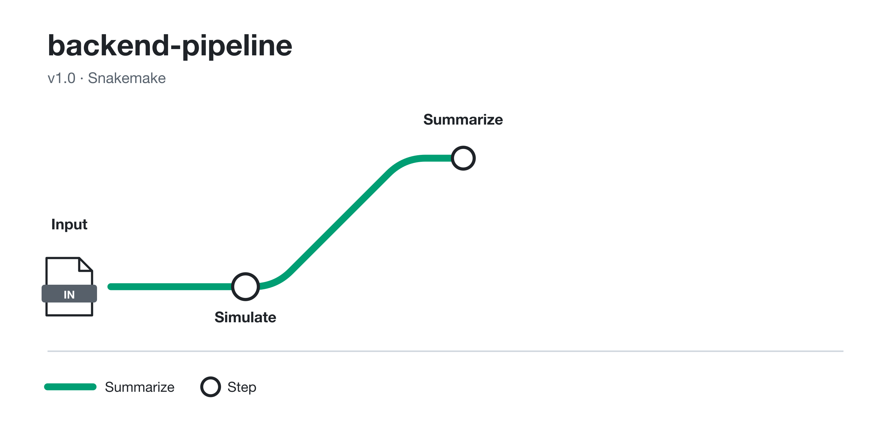
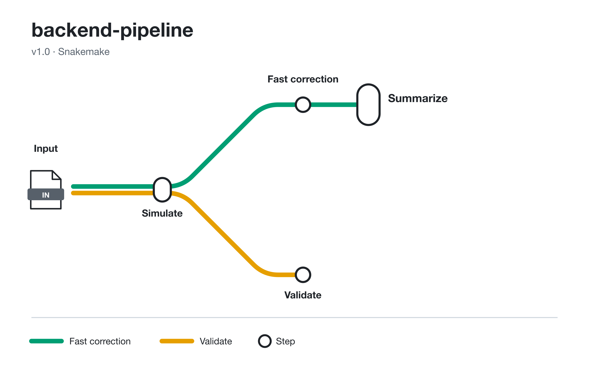
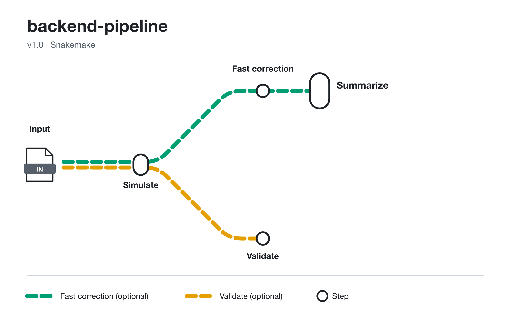

# `--scan` vs `--scan --compare`

A small made-up pipeline with two rules that are always **defined**, but only **used** for some backends. Reading
the Snakefile (`--scan`) can't tell they're optional; comparing with `snakemake --rulegraph` (`--compare`) can.

## The pipeline

[`backend-pipeline/Snakefile`](backend-pipeline/Snakefile), with [`config.yaml`](backend-pipeline/config.yaml)
choosing only the `default` backend (`backends: ["default"]`):

```python
BACKENDS = config["backends"]

rule all:
    input:
        "results/summary.csv",
        # 1. a target `rule all` only asks for under one backend
        expand("results/validation_{ref}.csv", ref=["reference"]) if "reference" in BACKENDS else [],

rule simulate:          # simulation.csv
rule fast_correction:   # simulation.csv -> fast_correction.csv
rule validate:          # simulation.csv -> validation_{ref}.csv

def summary_inputs(wildcards):
    inputs = ["results/simulation.csv"]
    if "fast" in BACKENDS:
        # 2. an input added by an input function only under one backend
        inputs.append("results/fast_correction.csv")
    return inputs

rule summarize:
    input: summary_inputs   # -> summary.csv
```

Neither `fast_correction` nor `validate` sits inside an `if` block, so `--scan` treats them as regular steps.

## Reproduce

From the `slitherFlow` folder (`--compare` and the default mode need Snakemake):

```shell
P=examples/compare/backend-pipeline
slitherflow draft $P                     --save-rulegraph rulegraph.dot -o default.yaml
slitherflow draft $P --scan              --save-rulegraph scan.dot      -o scan.yaml
slitherflow draft $P --scan --compare    --save-rulegraph compare.dot   -o compare.yaml
```

The last one prints:

```text
--compare: 2 rule(s) found by --scan aren't used by the current config, marked optional: fast_correction, validate
```

Render any of them with `slitherflow render compare.yaml --png`. The outputs are saved in this folder.

## The rule graphs

| [`rulegraph.dot`](rulegraph.dot): `snakemake --rulegraph` | [`scan.dot`](scan.dot): `--scan` | [`compare.dot`](compare.dot): `--scan --compare` |
|---|---|---|
| `all`<br>`summarize`<br>`simulate` | `all`<br>`simulate`<br>`fast_correction`<br>`summarize`<br>`validate` | `all`<br>`simulate`<br>`fast_correction`, **`optional = true`**<br>`summarize`<br>`validate`, **`optional = true`** |
| Only what this config runs | Every rule, none marked | Every rule; the two this config doesn't run are marked |

`compare.dot` is `scan.dot` with `optional = true` added to every rule that `rulegraph.dot` doesn't list:

```diff
 	1[label = "simulate"];
-	2[label = "fast_correction"];
+	2[label = "fast_correction", optional = true];
 	3[label = "summarize"];
-	4[label = "validate"];
+	4[label = "validate", optional = true];
```

## The drafts

The only change from [`scan.yaml`](scan.yaml) to [`compare.yaml`](compare.yaml) is the `optional` flag on the two
lines:

```diff
   line1:
     name: "Fast correction"
     row: -1            # negative = above the trunk
+    optional: true         # dashed: these steps only run for some configs
     to: "terminus"
@@
   line2:
     name: "Validate"
     row: 1
+    optional: true         # dashed: these steps only run for some configs
     to: "none"
```

## The maps

| Default (`snakemake --rulegraph`) | `--scan` | `--scan --compare` |
|---|---|---|
|  |  |  |
| Only the steps this config runs | Every step, all drawn as if they always run | Every step; the ones this config skips are dashed |

The comparison follows the config: with the `fast` backend switched on, only `validate` is marked.

```shell
slitherflow draft $P --scan --compare -o compare_fast.yaml -- --config 'backends=["default","fast"]'
# --compare: 1 rule(s) found by --scan aren't used by the current config, marked optional: validate
```

## Known drafting limits this example shows

These come from how the draft is laid out, not from `--compare`:

- When every line leaving the trunk is optional, the trunk itself is drawn dashed, although `Simulate` always runs.
- `simulate → summarize` feeds the end station directly, and the draft leaves out inputs to the end station,
  so the map only shows `Summarize` being reached through the optional `Fast correction`.
